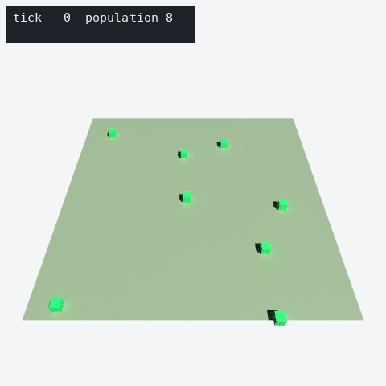

# usd-recorder

A flight recorder for simulations: call `record(tick, entities, extras, events)` once per tick and
get a time-sampled [OpenUSD](https://openusd.org) stage you can scrub in usdview, Blender, or any
USD tool.



*`examples/random_walkers.py` (300 ticks, `--chunk-size 100`), flattened with `usd-recorder flatten`
and replayed from the recorded time samples (position, visibility, colour, the `population` extra
and the `log` event channel) in headless Blender. Rendered by
[`docs/render_replay.py`](docs/render_replay.py).*

It packages the recording patterns proven in
[viron-usd](https://github.com/Preponderous-Software/viron-usd) (time-sampled entities, chunked
layers stitched with value clips, `flatten`) and
[acsf-usd-env](https://github.com/Preponderous-Software/acsf-usd-env) (cycle-indexed time codes,
string channels that must not leak between samples, live/follow mode with atomic writes) so a new
simulation does not have to rediscover them, including the two value-clip traps that cost a spike
to find.

- **Entity lifecycle.** Entities that are present are visible; absent ones are invisible, also
  *before* they first appear and also across chunk boundaries. Values hold while an entity is
  absent, so it never interpolates towards where it reappears.
- **Sparse sampling with hold keys.** A sample is written only when a value changes (plus one
  hold key), yet every recorded tick resolves to exactly the recorded value.
- **Typed extras.** `bool`, `int` (32-bit), `double`, `string` and `double3` values per entity
  and per stage; a key keeps its type for the whole recording.
- **Event channels.** A channel reads the event text on the tick it happened and `""` on every
  other tick, never a stale string held from an earlier event.
- **Chunked value clips.** `chunk_size=N` writes bounded chunk layers and stitches them into one
  root with `UsdUtils.StitchClips`, with the per-chunk time ranges and manifest defaults that make
  clips resolve correctly.
- **Live recordings.** `checkpoint_every=N` republishes the recording atomically every N ticks,
  so a viewer or `usd-recorder inspect` polling the file never reads a half-written layer.
- **`.usda` by default, `.usdc` with `binary=True`.** A CLI flattens and inspects recordings.
- **C++ writer.** A dependency-free header, `cpp/include/usd_recorder/usda_writer.hpp`, writes the
  same layout from C++ simulations (unchunked `.usda`).

## Install

```bash
pip install "usd-recorder @ git+https://github.com/Preponderous-Software/usd-recorder@v0.1.0"
```

Python 3.10+; depends only on `usd-core` (pinned to 26.8). Not on PyPI yet: pin the git tag.

## Quick start

```python
from usd_recorder import Recorder

with Recorder("out/run.usda", time_codes_per_second=24, chunk_size=500) as rec:
    for tick in range(2000):
        sim.step()
        rec.record(
            tick,
            entities={
                agent.id: {
                    "position": (agent.x, agent.y, 0.0),
                    "color": agent.rgb,  # on the entity's geometry
                    "energy": agent.energy,  # -> extras:energy (double)
                    "state": agent.state,  # -> extras:state (string, held)
                }
                for agent in sim.agents
            },
            extras={"population": len(sim.agents)},  # on /World
            events={"log": sim.events_this_tick},  # "" on ticks without events
        )
```

```bash
usd-recorder inspect out/run.usda           # time range, clips, sample counts, metadata
usd-recorder flatten out/run.usda           # -> out/run_flat.usda, every clip baked in
usd-recorder flatten out/run.usda --binary  # -> out/run_flat.usdc
```

A runnable example: `python examples/random_walkers.py out/run.usda --chunk-size 100`.

### Stage layout

```text
/World                         Xform, default prim; extras:<key>, events:<channel>
  Entities                     Scope
    e_7                        Xform: visibility, xformOp:translate, extras:<key>, recorder:id
      geom                     Cube (or Sphere, or none): primvars:displayColor
```

Options cover the root path, scope name, up axis, metres per unit, geometry and size, default
colour, prim naming, the attribute namespace, a `scene` hook for static geometry, and layer
metadata. See [ARCHITECTURE.md](ARCHITECTURE.md).

### Building blocks

The pieces the `Recorder` is made of are public, for consumers with their own stage layout
(viron-usd uses them this way): `Track` (sparse sampler with hold keys), `value_type` and
`SDF_TYPES` (typed values), `stitch` (atomic `StitchClips` with topology/manifest/root hooks),
`default_invisible` and `set_manifest_defaults` (manifest defaults), `flatten`, `has_clips`,
`atomic_export` and `atomic_write_bytes`.

### C++

```cpp
#include "usd_recorder/usda_writer.hpp"

usd_recorder::UsdaRecorder rec(10.0);
for (int tick = 0; tick < 100; ++tick) {
    rec.begin_tick(tick);
    rec.entity(7).position(x, y, 0).set("energy", 3.5).set("state", "hunting");
    rec.extra("clock", tick * 0.1);
    rec.event("log", "spawned");
    rec.end_tick();
}
rec.write("run.usda");
```

`tests/test_cpp_writer.py` compiles a scenario with `-Wall -Wextra -Werror -pedantic` and checks
that its stage has the same time samples as the Python `Recorder`'s for the same scenario.

## Development

```bash
uv venv -p 3.12 && uv pip install -e ".[dev]"
.venv/bin/python -m pytest
.venv/bin/ruff check . && .venv/bin/ruff format --check .
```

Docs: [CONCEPT.md](CONCEPT.md) (what and why), [ARCHITECTURE.md](ARCHITECTURE.md) (how, and the
traps).

## License

MIT, see [LICENSE](LICENSE).
